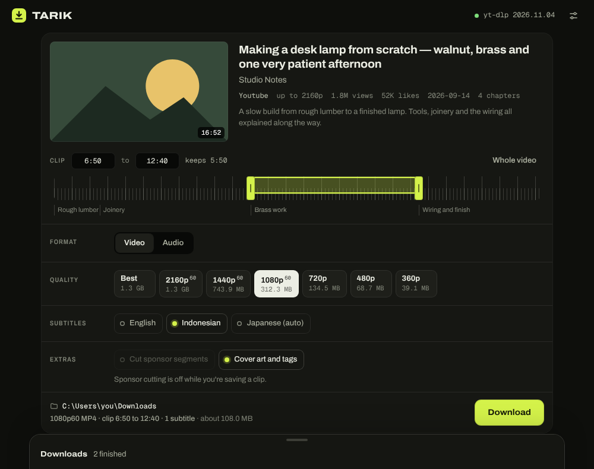
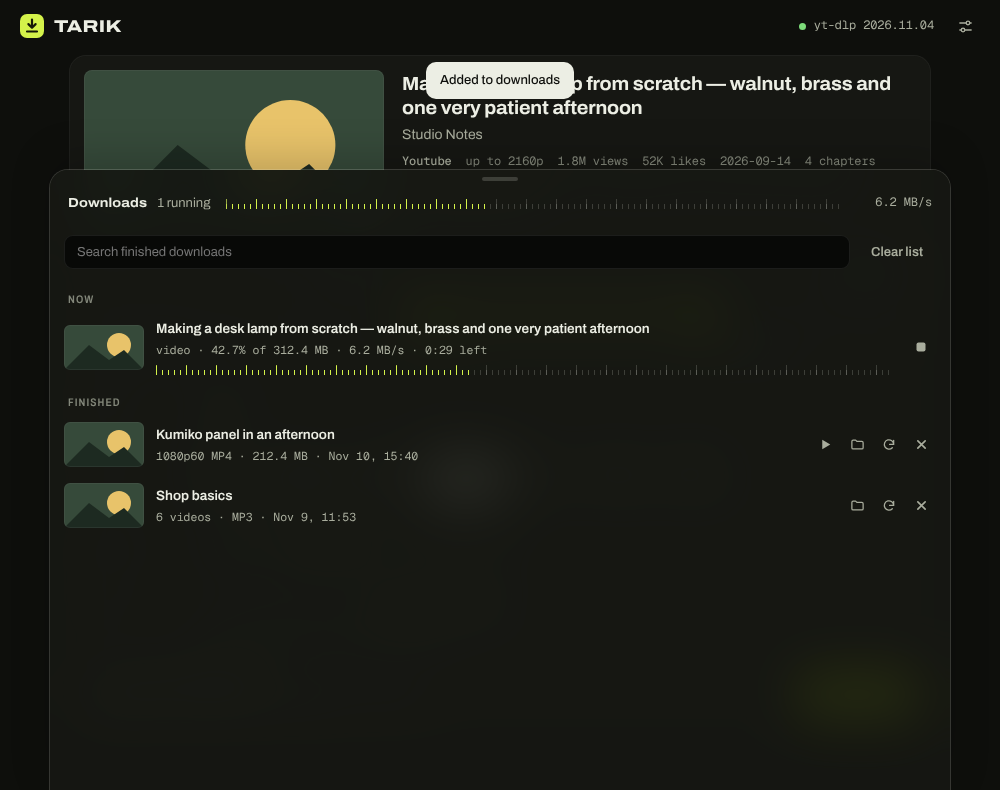

# Tarik

A small Windows app for saving video and audio from YouTube and about a thousand other sites.
Paste a link, pick what you want, pull it down. *Tarik* is Indonesian for "pull".

It is a window around [yt-dlp](https://github.com/yt-dlp/yt-dlp): one `.exe`, nothing to install.



## What it does

- Video up to 4K as MP4, or audio as MP3, M4A, Opus or WAV, with a size estimate for each choice
- Clip: drag the ruler (or click a chapter) to keep only part of a video
- Subtitles embedded in the file, sponsor segments cut out, cover art and tags
- Paste several links at once for a batch; pick individual videos out of a playlist
- A queue (1 to 3 at a time) and a history that survives restarts
- Borrow your browser's login for members-only videos, speed limit, file name patterns
- Light and dark themes, four accent colours



## Build

Needs Go 1.24+ and curl. On Windows, run it from Git Bash.

```sh
./build.sh        # fetches yt-dlp.exe, verifies its checksum, writes dist/Tarik.exe
```

The app needs the Microsoft Edge WebView2 Runtime, which Windows 11 already has.
On first start it copies yt-dlp to `%LOCALAPPDATA%\Tarik` and downloads
[Deno](https://deno.com) there, which yt-dlp needs for YouTube. For full quality, trimming and
conversion, install ffmpeg: `winget install Gyan.FFmpeg`.

## Tests

```sh
go test ./...                       # argument building, output parsing, info summary
python test/ui_check.py             # drives the UI in Chromium with a fake backend (needs playwright)
```

`TestEngine` runs the real yt-dlp when `TARIK_ENGINE_DIR` (a yt-dlp checkout) and
`TARIK_TEST_URL` (a direct video URL) are set.

## How it is put together

| File | Job |
| --- | --- |
| `ytdl.go` | Turns choices into yt-dlp arguments, reads its output, summarises video info. No Windows code, so it is testable anywhere. |
| `main.go` | Window, bridge between page and Go, running and cancelling yt-dlp, Deno download |
| `win.go` | Folder picker, title bar theme, clipboard, taskbar flash |
| `ui/index.html` | The whole interface: one file, no framework |

## Security notes

- yt-dlp always runs with `--ignore-config` from the app's own folder, so a `yt-dlp.conf` lying
  next to the app cannot add options such as `--exec`.
- Everything the page sends is checked against allowlists before it reaches the command line.
- The page has a Content-Security-Policy that only lets its own script run; titles and
  descriptions from sites are escaped before display.
- "Play" only opens media files. Anything else is shown in Explorer instead.
- Tarik looks for `ffmpeg.exe` and `deno.exe` next to `Tarik.exe` before `PATH`. Keep the app
  in a folder of its own rather than in Downloads.

## Credits

[yt-dlp](https://github.com/yt-dlp/yt-dlp) (Unlicense) does the real work.
Window by [go-webview2](https://github.com/jchv/go-webview2) (MIT).
Type: Archivo and Geist Mono, both under the SIL Open Font License (`ui/fonts`).

Only download what you have the right to download.
